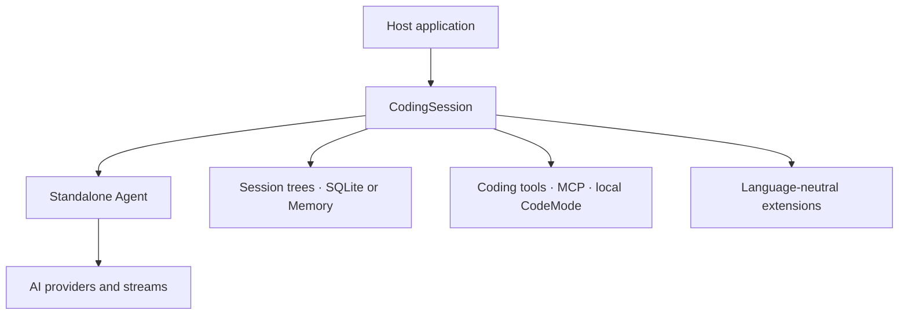

<p align="center">
  
</p>

<h1 align="center">Pirua</h1>

<p align="center">
  <strong>A Rust rewrite of the <a href="https://github.com/earendil-works/pi">Pi agent harness</a>.</strong>
</p>

<p align="center">
  <a href="rust-toolchain.toml"></a>
  <a href="#current-status"></a>
  <a href="LICENSE"></a>
</p>

<p align="center">
  <a href="#upstream">Upstream</a> ·
  <a href="#getting-started">Getting started</a> ·
  <a href="docs/architecture/index.md">Architecture</a> ·
  <a href="docs/development.md">Development</a>
</p>

Pirua reimplements Pi's AI, agent, and headless coding runtime layers in Rust.
It follows a pinned upstream baseline, with explicit mappings from upstream
contracts and observable behavior to Rust implementations and conformance evidence.
The current workspace provides libraries for embedding these runtime layers in
an application.

## Upstream

[Pi](https://github.com/earendil-works/pi), created by
[Mario Zechner](https://github.com/badlogic), is the upstream project. Pirua's
scope follows its AI and agent contracts and selected coding-agent runtime
responsibilities. The Rust APIs use traits and detached values at host boundaries;
the extension boundary uses a language-neutral protocol.

If you know Pi, these are the main entry points into this workspace:

| Pi area at the pinned baseline | Rust entry points | What lives here |
|---|---|---|
| `packages/ai` | [`pi-ai`](crates/pi-ai) | Models, streaming, authentication and four provider integrations |
| `packages/agent` | [`pi-agent`](crates/pi-agent) | Standalone Agent, tools, queues, hooks and an optional proxy stream |
| Headless `packages/coding-agent` | [`pi-coding-runtime`](crates/pi-coding-runtime), [`pi-coding-session`](crates/pi-coding-session) | Coding tools, resources, complete session trees, compaction and SQLite persistence |
| `packages/mcp` | [`pi-mcp`](crates/pi-mcp) | Reusable stdio and Streamable HTTP client with OAuth |
| `packages/codemode` | [`pi-codemode`](crates/pi-codemode) | One local JavaScript worker with explicit tool capabilities |
| `packages/telemetry` | [`pi-telemetry`](crates/pi-telemetry) | Telemetry contracts and process-local implementations |

The [crate map](docs/architecture/02-crate-topology.md) explains ownership and
dependencies. Crate names retain the upstream `pi-` prefix. Third-party extensions
connect through a host-authenticated, language-neutral protocol.

### Upstream baseline

The selected AI, Agent and Coding scope follows **Pi v1.4.0**, revision
[`4a080252f06c`](https://github.com/earendil-works/pi/tree/4a080252f06caf63a525d7873c5d94d3c23887e0).
The [ownership map](upstream-map.toml) records source responsibilities and explicit
exclusions. The [conformance registry](conformance/assembly.json) links those
responsibilities to offline checks. See [upstream updates](docs/upstream-drift.md)
for the process used to assess a candidate release.

## Current status

**Pre-release.** Workspace crates are version `0.0.0` with `publish = false`;
consume them from this checkout while the public API develops.

Built-in providers are **OpenAI, Google Gemini, Anthropic and DeepSeek**. All four
support API keys; OpenAI ChatGPT and Anthropic subscription login are optional
OAuth capabilities. Vision input is retained. Provider and native transport
features are selected explicitly.

Coding sessions support Memory and SQLite, including save/reopen, branches,
forks and compaction. MCP and CodeMode can be used independently or attached to a
Coding session. The workspace delivers headless libraries; the CLI/TUI,
JavaScript extension loader, JSONL storage and old-data import are outside its
[scope](docs/scope.md). The new Durable runtime is a separate upgrade; the
retired experimental Harness is available in Git history.

Conformance combines target-release source observations, native boundary tests
and retained transport fixtures. It does not imply complete parity with every
upstream package. [Development and verification](docs/development.md) explains
how to reproduce the checks and their evidence boundaries.

## Getting started

Clone the repository and prepare the checked-in Rust toolchain:

```sh
git clone https://github.com/utopia2077/pirua.git
cd pirua
rustup toolchain install 1.98.0 --profile minimal --component rustfmt --component clippy
cargo fetch --locked
```

Run the [offline Agent example](crates/pi-agent/examples/offline_agent.rs):

```sh
cargo run -p pi-agent --example offline_agent --locked --offline
```

It sends a prompt through the Agent, executes a local tool and prints the
settled transcript size. A deterministic local response is injected in place of a provider,
so this example needs no API key, network access, or upstream checkout after
dependencies are cached. Its central flow is:

```rust
let agent = Agent::new(local_options());
agent.prompt_text("Hello, Pirua!", Vec::new()).await?;

let state = agent.state();
println!("{}", serde_json::to_string_pretty(&state.messages)?);
```

The complete source includes the model, message, and response helpers. For a
provider-backed host, supply the provider/model callbacks and credentials through
the documented composition boundaries.

To check all Rust targets:

```sh
cargo check --workspace --all-targets --locked --offline
```

Full conformance also runs Node/Python peers and pinned upstream oracles. Follow
[Development and verification](docs/development.md) to prepare those inputs.

## Runtime layout



This is a composition overview. The
[architecture](docs/architecture/index.md) describes the full crate graph,
runtime contracts, extension protocol, and host responsibilities.

## Documentation

| Start here | Contents |
|---|---|
| [Architecture](docs/architecture/index.md) | System boundaries, crate ownership, storage, extensions, and coding integration |
| [Scope](docs/scope.md) | Included upstream responsibilities, provider selection, and exclusions |
| [Development](docs/development.md) | Features, prerequisites, builds, tests, and verification commands |
| [Upstream updates](docs/upstream-drift.md) | Compare pinned revisions and review classified changes |

## Acknowledgements and license

Pirua follows the work of Mario Zechner and the
[Pi contributors](https://github.com/earendil-works/pi). Upstream contracts,
implementations, and tests inform the Rust rewrite and its conformance suite.
Captured catalog data also includes material from [models.dev](https://models.dev/).

[MIT](LICENSE). Copyright notices for Pirua contributors, Mario Zechner, and
models.dev are retained together in the root license. [NOTICE](NOTICE) records
source attribution, the pinned baseline, and captured-data provenance.
