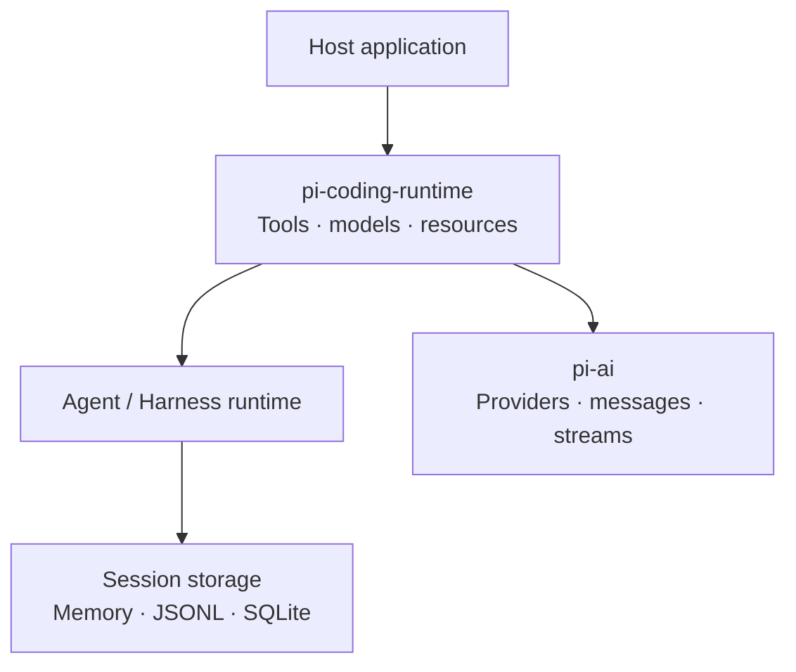

<p align="center">
  
</p>

<h1 align="center">Pirua</h1>

<p align="center">
  <strong>A Rust rewrite of the <a href="https://github.com/earendil-works/pi">Pi agent harness</a>.</strong>
</p>

<p align="center">
  <a href="rust-toolchain.toml"></a>
  <a href="#current-status"></a>
  <a href="LICENSE"></a>
</p>

<p align="center">
  <a href="#upstream">Upstream</a> ·
  <a href="#getting-started">Getting started</a> ·
  <a href="docs/architecture/index.md">Architecture</a> ·
  <a href="docs/development.md">Development</a>
</p>

Pirua reimplements Pi's AI, agent, and headless coding runtime layers in Rust.
It follows a pinned upstream baseline, with explicit mappings from upstream
contracts and observable behavior to Rust implementations and conformance evidence.
The current workspace provides libraries for embedding these runtime layers in
an application.

## Upstream

[Pi](https://github.com/earendil-works/pi), created by
[Mario Zechner](https://github.com/badlogic), is the upstream project. Pirua's
scope follows its AI and agent contracts and selected coding-agent runtime
responsibilities. The Rust APIs use traits and detached values at host boundaries;
the extension boundary uses a language-neutral protocol.

If you know Pi, these are the main entry points into this workspace:

| Pi area at the pinned baseline | Rust entry points | What lives here |
|---|---|---|
| `packages/ai` | [`pi-ai`](crates/pi-ai) | Model and provider contracts, messages, streaming, authentication, and selected provider integrations |
| `packages/agent` | [`pi-agent`](crates/pi-agent), [`pi-harness-core`](crates/pi-harness-core), [`pi-harness-runtime`](crates/pi-harness-runtime) | Agent loop compatibility, Harness planning, execution, hooks, and recovery |
| Harness session and backend contracts | [`pi-agent-session`](crates/pi-agent-session), [`pi-agent-sqlite`](crates/pi-agent-sqlite), [`pi-agent-search`](crates/pi-agent-search) | Session trees, Memory/JSONL/SQLite storage, migration, and search |
| Headless parts of `packages/coding-agent` | [`pi-coding-runtime`](crates/pi-coding-runtime) | Coding tools, model composition, prompts, resources, and session lifecycle |
| `packages/telemetry` | [`pi-telemetry`](crates/pi-telemetry) | Telemetry contracts and local reference implementations |

The full [fifteen-crate map](docs/architecture/02-crate-topology.md) explains
ownership and dependencies. Crate names retain the upstream `pi-` prefix.

### Upstream baseline

The current baseline is
[`853a80d26c90`](https://github.com/earendil-works/pi/tree/853a80d26c90a14c1886f0ebb8ffaae133ca2185).
Alignment is evaluated against that pinned revision and its applicable contracts,
rather than the latest upstream branch. The [ownership map](upstream-map.toml),
[conformance registry](conformance/assembly.json), and
[upstream update guide](docs/upstream-drift.md) make the correspondence reviewable.

## Current status

**Pre-release.** Workspace crates are version `0.0.0` with `publish = false`;
consume them from this checkout while the public API develops. The current scope
is the headless library runtime. Pi's interactive CLI/TUI and JavaScript extension
loading remain outside this workspace's scope.

Built-in text integrations cover **OpenAI, Google Gemini, Anthropic, DeepSeek,
OpenAI Codex, and OpenRouter**. Image integration is through **OpenRouter Images**.
Provider, OAuth, image, and storage features are selected explicitly. See the
[accepted scope](docs/scope.md) and
[feature and host boundaries](docs/development.md#feature-and-host-boundaries)
for the exact selectors and integration responsibilities.

Conformance includes source, contract, and offline behavior checks. The
[verification guide](docs/development.md#assembly-consistency) records tested
behavior, accepted compatibility gaps, and evidence boundaries.

## Getting started

Clone the repository and prepare the checked-in Rust toolchain:

```sh
git clone https://github.com/utopia2077/pirua.git
cd pirua
rustup toolchain install 1.98.0 --profile minimal --component rustfmt --component clippy
cargo fetch --locked
```

Run the [offline Agent example](crates/pi-agent/examples/offline_agent.rs):

```sh
cargo run -p pi-agent --example offline_agent --locked --offline
```

It sends a prompt through the compatibility Agent loop and prints the settled
transcript. A deterministic local response is injected in place of a provider,
so this example needs no API key, network access, or upstream checkout after
dependencies are cached. Its central flow is:

```rust
let agent = Agent::new(local_options());
agent.prompt(vec![user("Hello, Pirua!")]).await?;

let state = agent.state();
println!("{}", serde_json::to_string_pretty(&state.messages)?);
```

The complete source includes the model, message, and response helpers. For a
provider-backed host, supply the provider/model callbacks and credentials through
the documented composition boundaries.

To check all Rust targets:

```sh
cargo check --workspace --all-targets --locked --offline
```

Full conformance also runs Node/Python peers and pinned upstream oracles. Follow
[Development and verification](docs/development.md) to prepare those inputs.

## Runtime layout



This is a composition overview. The
[architecture](docs/architecture/index.md) describes the full crate graph,
runtime contracts, extension protocol, and host responsibilities.

## Documentation

| Start here | Contents |
|---|---|
| [Architecture](docs/architecture/index.md) | System boundaries, crate ownership, storage, extensions, and coding integration |
| [Scope](docs/scope.md) | Included upstream responsibilities, provider selection, and exclusions |
| [Development](docs/development.md) | Features, prerequisites, builds, tests, and verification commands |
| [Upstream updates](docs/upstream-drift.md) | Compare pinned revisions and review classified changes |

## Acknowledgements and license

Pirua follows the work of Mario Zechner and the
[Pi contributors](https://github.com/earendil-works/pi). Upstream contracts,
implementations, and tests inform the Rust rewrite and its conformance suite.
Captured catalog data also includes material from [models.dev](https://models.dev/).

[MIT](LICENSE). Copyright notices for Pirua contributors, Mario Zechner, and
models.dev are retained together in the root license. [NOTICE](NOTICE) records
source attribution, the pinned baseline, and captured-data provenance.
