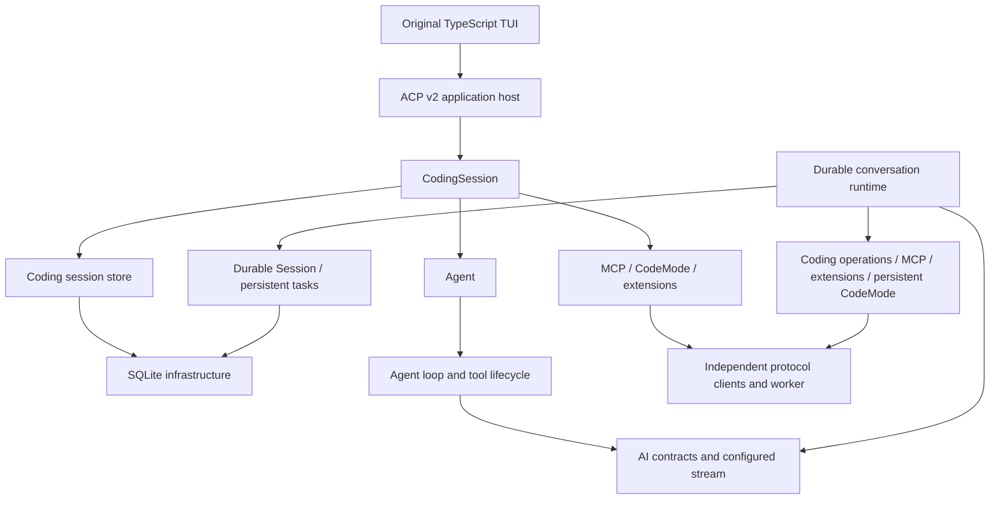

# Architecture

Pirua is a set of Rust libraries for embedding the selected Pi AI, Agent and
headless Coding capabilities. The current [scope](../scope.md) names the v1.4.0
baseline and exclusions. Crate READMEs describe the implemented native APIs.
The original TypeScript terminal UI is also available through a native ACP
application host; it uses the same CodingSession and session store.

| Document | Responsibility |
|---|---|
| [Principles and scope](01-principles-and-scope.md) | State ownership and host boundaries |
| [Crate topology](02-crate-topology.md) | Exact workspace members and internal dependencies |
| [AI subsystem](03-ai-subsystem.md) | Providers, streams, catalogs and authentication |
| [Agent](04-agent-harness.md) | Transient execution, events and tool lifecycle |
| [Session storage](05-session-storage.md) | Separate Coding and Durable records, projection and transactions |
| [Extensions](06-extension-protocol.md) | Host grants and current language-neutral bindings |
| [Coding integration](07-coding-integration.md) | Session orchestration and reusable tools |
| [Upstream synchronization](08-upstream-sync.md) | Immutable baselines, ownership and evidence |
| [Conformance boundaries](09-conformance-security.md) | Offline checks and host obligations |
| [Terminal integration](../design/tui-acp-v2.md) | ACP lifecycle, native input receipts and frontend mirrors |

The [Durable Session](../contracts/durable-session.md) owns committed documents,
history and storage independently of CodingSession. The [generic scheduler](../contracts/durable-scheduler.md)
in `pi-durable` executes persistent tasks over that Session. The
[conversation runtime](../contracts/durable-runtime.md) adds model/tool execution,
committed views/events and native bindings. [Persistent local CodeMode](../contracts/durable-codemode.md)
journals worker replay and effect admission over the same authority. Shared AI,
tool, SQLite, MCP and CodeMode
modules have no dependency on that runtime. The old experimental Harness is retired
from the workspace and remains in Git history.
