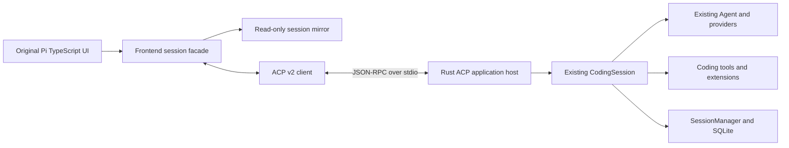

# Pi TypeScript TUI over ACP v2

Status: implemented and verified offline. The original Pi TypeScript terminal UI
runs with Rust CodingSession as its execution backend. The runtime, application
host and frontend passed independent implementation review, protocol/native tests
and real terminal checks. [The terminal guide](../tui.md) documents launch,
verification commands and the remaining live-provider/platform limits.

## Purpose and scope

Pi's terminal renderer, editor, Markdown and image rendering, interactive components,
themes, key bindings and session navigation are useful independently of the language
that runs the agent. The accepted Rust Agent/Coding implementation already owns the
agent loop, selected providers, coding tools, hooks, compaction and SQLite sessions.
The missing boundary is an application protocol and a frontend session adapter.

Deliver a locally launchable TypeScript TUI connected to a Rust stdio server. The
server also serves ordinary ACP clients without Pi extensions. The TUI must execute
prompts and tools through Rust, stream responses, cancel work, steer and follow up,
select models and thinking settings, reopen sessions, navigate the session tree,
fork and compact. Preserve the original UI components and rendering behavior; do
not replace them with a new terminal application or run the JavaScript agent loop.

The existing accepted runtime scope still applies. This change does not introduce
Durable scheduling, task execution, JSONL storage compatibility, new providers,
a remote execution sandbox, or an unrestricted JavaScript backend extension loader.
Local UI rendering callbacks remain a frontend concern. Features requiring a host
capability that is absent must be unavailable with an actionable explanation; they
must not succeed as no-ops or fall back to the upstream JavaScript agent.

## Source authority and compatibility

| Source | Pinned identity | Role |
| --- | --- | --- |
| Pi | `v1.4.0`, `4a080252f06caf63a525d7873c5d94d3c23887e0` | Original terminal UI and accepted runtime behavior |
| ACP | `6f29ef9a4913d16900abf7f88437eedba38c5e05` | v2 wire and lifecycle contract |
| ACP v2 schema | `2.0.0-alpha.9`, `schema/v2/schema.json` | Baseline v2 schema artifact at the pin |
| Codex | `94350a9101` | Application-server separation and lifecycle reference |
| Codex ACP adapter | `082be156aacac3ef21e231da2efcdf5f6af34a6b` | Concrete mapping from an application server to ACP v2 |

ACP v2 is a draft. Selecting `protocolVersion: 2` does not make it a stable release,
and does not enable every experimental field in `schema.unstable.json`. Pin the
schema bytes and digest in the repository. Regenerate or review both endpoints
together when changing that pin. The initial server implements v2 only: a client
requesting version 1 receives ACP error `-32022` with requested/supported versions.
There is no silent conversion between v1 and v2 lifecycle semantics.

Codex is a design reference, not the wire specification. In particular, use ACP's
JSON-RPC `"jsonrpc":"2.0"` envelope and ACP insertion/state semantics. Do not copy
Codex's omission of that field or equate its turn-start response with ACP completion.

## Boundaries and ownership

The Rust host owns session admission and lifetime, executes every backend operation,
and projects runtime events into ACP. CodingSession and SessionManager keep their
existing authority over agent state and persisted history. The host does not create
a second conversation store or take over Durable state.

The TypeScript client owns terminal I/O, editor state, focus, overlays, presentation
preferences, local clipboard and rendering callbacks. For this same-machine stdio
deployment it also retains upstream local reads for path completion, Git status and
predictive edit diffs; the executed edit and final diff still come from Rust. Remote
working directories require a separate filesystem design and are not implied here.
Its mirror supplies synchronous
reads needed by original components. These are snapshots of server state, not writable
runtime objects. UI operations use asynchronous facade methods; direct mutations such
as assigning `agent.transport` become explicit supported commands or configuration.

One connection may own multiple open sessions, but one original InteractiveMode
displays one selected session. Request IDs identify requests on a connection; session
IDs identify persisted conversations; message IDs identify ACP entities. A queued
submission has its own ID and is not a message merely because it has an identifier.

## Transport and lifecycle

Use UTF-8 JSON-RPC 2.0 messages separated by newlines on stdin/stdout. Literal newlines
inside JSON strings are escaped. stdout contains protocol messages only; diagnostics
go to stderr. The TUI launches the configured Rust executable as a child with pipes;
the child never reads the terminal. The client continuously drains stdout independently
of rendering and request waits, and routes responses, notifications and reverse requests.
Accept JSON-RPC batches as one array per line, with the standard per-item request/error
rules. Notifications receive no response, including in a notification-only batch.

Initialization precedes session operations. Advertise only implemented capabilities.
`capabilities.session: {}` commits the server to all seven baseline methods:
`session/new`, `session/list`, `session/resume`, `session/close`, `session/prompt`,
`session/cancel` and `session/update`. Configuration and optional content have their
own support rules. Unknown object fields are ignored; unknown open variants have a
safe fallback; malformed recognized variants remain errors.

Reject invalid parameters with `-32602`, unknown methods with `-32601`, and an
uninitialized operation with the protocol's applicable error. Do not disguise a
backend failure as an empty successful result. A failed child or EOF rejects pending
client requests, stops spinners and restores terminal modes. Process shutdown cancels
active work and releases sessions; a live TUI must not remain waiting for a vanished
backend. The initial delivery is local stdio, without reconnect or a durable event log.

## Standard ACP behavior

| User behavior | ACP surface | Pi-specific information, if needed |
| --- | --- | --- |
| Start/list/reopen/close conversation | `session/new`, `list`, `resume`, `close` | Read-only tree and renderer snapshot |
| Submit text or supported images | `session/prompt` | Input origin metadata, never a queue acknowledgement |
| Assistant text and thinking | Identified whole/chunk updates | Renderer metadata only |
| Tool progress and result | `tool_call_update`, content chunks | Original tool name, structured details, timing |
| Foreground state and cancellation | `state_update`, `session/cancel` | Queue is separately identified |
| Select model/thinking | Session configuration options | Only configuration not expressible by the standard |
| Slash commands and compaction | Advertised commands through prompt; compaction updates | Tree effects and original renderer details |
| Credentials/login | Advertised ACP authentication methods | Host-specific credential setup, no secret mirror |
| Tree navigation and entry-specific fork | Namespaced Pi operation | Entry ID, parent/leaf identity and revision |
| Steering/follow-up | Namespaced Pi operation | Delivery policy, submission ID and lifecycle |

The server executes tools. ACP v2 terminal updates describe agent-owned terminals;
they do not delegate arbitrary tool execution to the TUI. There is no implicit client
filesystem or terminal-execution API. File/resource links in prompts are handled as
context references under baseline ACP rules, not blindly fetched as arbitrary URLs.

### Prompt insertion and identity

`session/prompt` succeeds **when the user message is logically inserted**, returning
its `messageId`, without waiting for generation to finish. Receipt, preprocessing,
queueing and ID allocation are not insertion. The corresponding `user_message`
update carries the same ID and may precede or follow the response. Retained user
messages keep that ID when replayed after restarting the process.

Before insertion, failure produces a request error. After insertion, the prompt
response must succeed even if work immediately fails or is cancelled; work outcome
arrives through `state_update`. For a locally handled slash command that has no
runtime history entry, the host may insert an explicitly live-only ACP user message.
No client infers insertion by comparing text: identical prompts and transformed
prompts must remain distinguishable.

`$/cancel_request` cancels a pending request under ACP request-cancellation rules.
`session/cancel` cancels foreground session activity, including pending prompt
admission before the runtime installs its active operation. Close and connection
shutdown also cancel these admissions. Once a message is inserted,
request cancellation cannot retroactively remove it or turn its response into an
error. Losing a response does not permit automatic prompt retry: the server provides
no cross-connection idempotency guarantee in this version.

### State and event ordering

Map final CodingSession settlement to ACP idle state. An intermediate agent-end event
can precede retry or compaction, so it must not by itself report session completion.
Report running while foreground work continues; error or cancellation is an idle
state with the matching stop reason, not a late prompt error after insertion.

Runtime callbacks enqueue ordered observations without waiting for terminal rendering
or user responses. The server's output writer is the only stdout writer. Never hold
a runtime/session mutex across protocol request waits. Input admission and tree
mutations have explicit serialization, while cancellation and the input reader stay
responsive during provider streaming. Backpressure may terminate an unresponsive
connection; it must never silently drop lifecycle or insertion events and keep using
an inconsistent mirror.

Entity updates use `(type, id)` identity. Omitted fields retain state, explicit null
clears nullable fields, whole content replaces content, and chunks append. `_meta`
on ACP upsert entities is a top-level key patch: omitted keys remain, null removes
a key, and other values replace the key's entire value. Nested objects do not merge.

### Resume and close

Every successful `session/resume` emits the current `state_update` before its
response, including when `replayFrom` is omitted or null. That form does not replay
history. With
`replayFrom: {"type":"start"}`, send retained active-branch history followed by the
current `state_update` before the response. Reject unsupported or malformed replay
cursors; never silently substitute another cursor. A frontend that reloads its
mirror clears the relevant projection explicitly before applying a complete replay.

Closing active work sends final updates and idle/cancelled state before the successful
close response. A prompt prevented from insertion receives `-32800`; an already
inserted prompt still receives its message ID. Closing releases the active session,
not its retained SQLite history. List/resume work after reopening the server.

## Pi extension principles

Use a versioned namespaced capability under `capabilities._meta`, and namespaced
methods beginning with `_`. Do not add custom fields to ACP-defined object roots.
Only advertise a Pi capability when its complete behavior is implemented. Absence
means unsupported; the frontend must not assume support merely because it is Pi.

An extension is justified by semantics missing from ACP: queued-input delivery policy,
Pi's parent-linked entry tree, or rendering information the original components need.
Do not invent private replacements for standard text streaming, model selection,
authentication or lifecycle methods. Optional renderer metadata may be ignored by an
ordinary ACP client without changing execution correctness.

### Version 1 capability and methods

Both peers advertise `capabilities._meta["pirua.dev/tui"]: {"version":1}`. The
server additionally supplies a `features` array containing implemented groups from
`snapshot`, `queue`, `tree`, `shell`, `scopedModels` and `resources`. A group enables
the complete method set below for that group. A client must check version and group
before calling. An unrecognized version does not negotiate this profile. Standard
ACP remains usable without this capability; the full original Pi client requires
the snapshot profile and explains a mismatch before entering interactive mode.

| Group | Method | Parameters after `sessionId` | Result |
| --- | --- | --- | --- |
| snapshot | `_pirua/session/snapshot` | none | `PiSnapshot` |
| queue | `_pirua/session/queue` | `delivery: "steer" \| "followUp"`, `prompt: ContentBlock[]` | `QueueAdmission` |
| queue | `_pirua/session/clear_queue` | none | `{removed: QueuedInput[]}` |
| tree | `_pirua/session/navigate` | `targetId`, optional `expectedRevision`, `summarize`, `customInstructions`, `replaceInstructions`, `label` | `SessionChange` |
| tree | `_pirua/session/fork` | `entryId`, `position: "before" \| "at"`, optional `expectedRevision` | `SessionChange` |
| tree | `_pirua/session/label` | `entryId`, `label: string \| null`, optional `expectedRevision` | `{snapshot: PiSnapshot}` |
| tree | `_pirua/session/rename` | `name` | `{}`; also standard session-info update |
| shell | `_pirua/session/bash` | `command`, optional `excludeFromContext` | Native `BashResult` |
| scopedModels | `_pirua/session/scoped_models` | `models: {provider, modelId, thinkingLevel?}[]` | `{snapshot: PiSnapshot}` |
| resources | `_pirua/session/reload` | none | `{snapshot: PiSnapshot, diagnostics: ResourceDiagnostic[]}` |

`ContentBlock` means the pinned ACP type and follows the same content capability
checks as prompt. `QueueAdmission` is either `{disposition:"queued", submissionId}`
or `{disposition:"handled"}`. It never includes an insertion `messageId` merely for
queueing. A `QueuedInput` contains `submissionId`, `delivery`, `text` and `images`
in native Pi image format. Queue entries contain the actual admitted/transformed
input, so restoring removed inputs to the editor does not reconstruct them from
the original request. Duplicate text has distinct IDs.

`SessionChange` contains `sessionId`, `cancelled`, optional `aborted`, `editorText`, and
`snapshot`. A cancelled operation keeps the source session and snapshot unchanged.
Navigation follows CodingSession semantics: selecting a user entry branches to its
parent and returns that user's text to the editor. Fork creates a separate runtime
owner and session, retaining the original persisted session and its owner. `before`
requires a user entry, copies its parent path and returns that user's text to the
editor; `at` includes the selected entry and supports the original current-leaf clone
flow. A session ID must never continue
to address a runtime whose internal session ID has changed. The frontend explicitly
switches to the returned ID and may close the previous owner. `aborted` distinguishes
an interrupted branch summary from a before-change hook cancellation so the original
tree picker can reopen at the interrupted selection.

Tree/label/scoped-model mutations require idle session ownership. An active operation
returns a structured busy error; it does not silently abort the turn. Optional
`expectedRevision` is compared atomically with admission, and a mismatch returns a
structured stale-revision error plus the current revision. It is a concurrency guard,
not a general compare-and-swap storage API. The TUI refreshes before repeating an
operation whose target changed. Standard prompts submitted while busy are rejected
with a busy error; Pi clients explicitly choose queue delivery. The interactive host
drives admitted queued inputs: if the current driver finishes before consuming them,
it starts a continuation using those actual queued inputs. It must not leave an
accepted submission stranded by an idle/queue admission race. This is host policy;
the lower runtime's standalone queue API keeps its accepted explicit queue behavior.

Use extension error code `-32050` with `data.kind` of `busy`, `stale_revision`,
`unsupported` or `operation_failed` for these application conditions. Standard
protocol parsing, invalid parameters, cancellation and version errors retain their
standard codes. No failed operation is reported as a successful empty result.

Compaction uses the advertised `/compact` slash command over `session/prompt`. The
host inserts a live-only command message and responds, then runs real compaction,
emits standard compaction/state updates, and publishes changed history. The facade
waits for completion when its original caller needs the compaction result. Manual
shell commands use the Rust `execute_bash` implementation; stdout chunks use ACP
agent-owned terminal updates. The shell request's cancellation cancels that shell
operation. `session/cancel` and close cancel all active work owned by the session,
withdraw remaining queued inputs and resolve them as cancelled. Reject new admission
while cancellation is settling. A cancelled driver never restarts its queued cohort;
automatic continuation applies only to normal completion with still-admitted input.
The original Escape flow can first clear and restore genuinely removed inputs to
the editor, then cancel the remaining work.

### Snapshot and change projection

The following fields form `PiSnapshot` version 1. All arrays and objects are detached
data. Native types here refer to the accepted Rust serializable contracts, not Rust
object references. No credential, callback, tool executor or cancellation object
appears on the wire.

| Field | Meaning |
| --- | --- |
| `sessionId`, `epoch`, `sequence` | Session ID; opaque activation epoch; last applied host projection sequence |
| `history` | Native `SessionSnapshot` with `header`, `revision`, `leafId`, `entries`; timestamps are Unix milliseconds |
| `messages`, `contextEntries` | Current context's native Pi messages and projected source entries; distinct from full retained branch history |
| `liveEntities` | Materialized current ACP messages/thoughts/tools/terminals for active work, with IDs and whole accumulated content; never a list of unapplied chunks |
| `state` | `idle`, `running` or `requires_action` |
| `model`, `routedModel`, `thinkingLevel`, `availableThinkingLevels` | Current selections and available thinking values; unavailable optional selections are null |
| `models`, `scopedModels`, `configOptions` | Server catalog, scoped selection and ACP configuration choices |
| `queue` | `{steering: QueuedInput[], followUp: QueuedInput[]}` |
| `activity` | `{compacting, retrying, retryAttempt, bashRunning}` |
| `stats`, `contextUsage` | Native session statistics and context usage, or null when unknown |
| `settings`, `resources`, `tools` | Execution settings, resource descriptors/diagnostics and tool declarations sufficient for presentation |
| `authMethods` | The advertised authentication methods with their `_meta["pirua.dev/auth"]` subscription flag and configured status, as of the last `initialize`, `auth/login` or `auth/logout`; empty without form elicitation |

The host emits `_pirua/session/changed` only to negotiated clients, with
`{sessionId, epoch, sequence, changes, historyChange?, inputResolution?}`. `changes`
contains complete replacement values for the supplied `PiSnapshot` fields, excluding
identity and history. Omitted fields remain unchanged. `historyChange` is either
`{kind:"append", baseRevision, revision, appended, leafId}` or
`{kind:"replace", history}`. An empty append can move the leaf. Apply append only
to its matching session/epoch/base revision; otherwise fetch a new snapshot. This
is a process-local projection stream, not a reconnect log or persistence protocol.

`inputResolution` is `{submissionId, outcome, messageId?, error?}` where outcome is
`inserted`, `handled`, `cancelled` or `rejected`. Only `inserted` includes the retained
message ID. Queue clear reports only inputs actually withdrawn from the Agent FIFO;
inputs already drained for execution resolve later. Resolve every admitted ticket
exactly once on insertion, handling, rejection, withdrawal or shutdown.

Standard `session/update` notifications for negotiated Pi clients also carry
`params._meta["pirua.dev/projection"]: {epoch, sequence}`. The host increments a
per-session sequence across both standard and Pi change notifications. Snapshot
requests are serialized through the projection owner; the snapshot cursor covers
all earlier observations, and later updates have larger sequences. The frontend
buffers notifications while hydrating, installs the snapshot, then applies only
later updates from the same epoch. Changing session/epoch discards old transient
entities. Output from an old selected session cannot update the new screen.

The snapshot cursor is a complete projection boundary: materialize every in-flight
entity's accumulated text, thinking, tool state/output and terminal output in
`liveEntities` before advancing its cursor. `messages` alone is insufficient because
the runtime does not append a streaming assistant until message completion. On
hydration rebuild committed views from history/context and active views from these
identified entities, then apply later notifications. Never discard covered chunks
without their accumulated entity data in the installed snapshot.

For an in-flight native assistant, snapshot entity metadata includes its complete
current partial message in `pirua.dev/render.message`. This preserves the original
indexed text/thinking/tool slots, which aggregated ACP text plus the latest chunk's
`contentIndex` cannot reconstruct. The live chunk path still sends small deltas;
materializing a snapshot does not require retransmitting the full partial each token.

The normal streaming path sends chunks and small updates. It does not publish a
full transcript for every token. History append notifications follow successful
commits; full history replacement is reserved for initial state, resynchronization
and structural replacement. Snapshot state distinguishes canonical persisted history
from in-flight content already held by the host's entity projection.

### Renderer metadata

Standard content/tool/state updates remain complete for ordinary ACP clients. For
the Pi client, `update._meta["pirua.dev/render"]` may carry presentation information
not expressible by ACP: native message fields/usage, original assistant content index,
message phase (`start`, `delta`, `end`), parent assistant identity, tool duration and
structured display details. An original tool's arguments and result use standard
`rawInput`/`rawOutput` where applicable. Final message metadata may include the full
native message for faithful rendering and footer statistics; it must agree with
the standard content emitted for the same message.

The exact renderer envelope has fields `phase`, `nativeMessageId`, optional `message`
(native Pi message), `contentIndex`, `deltaType`, `toolCallId`, `parentMessageId`,
`entryId`, and `durationMs`.
`deltaType` uses the existing Pi assistant-delta discriminators. The adapter derives
original presentation events from standard entity updates plus this envelope; it
never relies on a separate stream of arbitrary backend events. A completed thought
and text portion can belong to the same original assistant message; retain their
shared native identity when rebuilding the original component's content array.
For one assistant response the standard text and thought entities use the same
`messageId` and renderer `nativeMessageId` (ACP distinguishes their entity types).
Related tool updates carry `parentMessageId` equal to that assistant ID and
`toolCallId` equal to the original Pi call ID. The ACP tool ID may additionally be
scoped by its parent to avoid reusing a tool entity. Do not infer parent association
from arrival order. Retained user IDs use their entry IDs. Retained assistant,
thought and associated tool identities remain stable across owner reconstruction
and replay within the same session. Assistant identities count the complete
append log, including inactive branches and omitted recovery attempts. Live-only
operation IDs include the activation identity. These retained-message guarantees
do not assign a durable identity to streaming content whose store commit failed.

Compaction start and terminal updates share one `compactionId`. A successful
terminal update carries the exact committed compaction `entryId` in renderer
metadata; cancellation and failure carry their own status without a prior result.
The mirror derives completion from this operation's standard outcome, including
outcomes covered by snapshot hydration, rather than from an activity flag or the
latest historical summary. Active compaction entities are included in snapshots.
During a snapshot refresh, the original UI retains an executing manual-shell row
until the corresponding canonical shell entry can replace it.

## Runtime additions

Keep the established AgentEvent/SessionEvent serialized contract and callback order.
Add an opaque transient input token outside provider message content. Carry it through
the Agent's actual FIFO records, initial/pending loop inputs and start/end message
transformations. Untracked existing APIs retain their current behavior. Do not infer
an input token from text, timestamp, image data or hook-transformed payload equality.

Expose tracked prompt/queue admission with a one-shot resolution ticket and an
explicitly owned driver future. A tracked prompt starts the same existing CodingSession
flow; its ticket resolves separately from generation completion. Successful user
commit resolves `Inserted {entryId, message}` using the real persisted entry ID.
The ACP projection inserts that user message at this commit boundary, never at the
earlier legacy MessageEnd callback. A failed user commit yields no ACP insertion;
discard/rebuild that failed owner's provisional live context before further admission.
A later assistant commit failure cannot revoke the already inserted user's receipt.
Handled input is a distinct outcome, never an inferred successful prompt insertion.

Add atomic canonical-history observation: obtaining the initial SessionSnapshot and
registering future successful commits share the manager ownership boundary. Emit
ordered append/leaf changes only after the commit succeeds and the snapshot updates;
emit replacement on changing managers. The observation sink only enqueues detached
data while that boundary is held. It never awaits, calls a user hook or reenters the
session. Cover all commit paths, including name/label/model/thinking, compaction,
custom entries and user shell. The subscriber's drop removes the observer.

This is atomic for history, not all transient runtime state. The application host
owns normal mutations and serializes a separate transient projection. It registers
observers before admitting work and spawns long operations outside its receive loop.
Driver completion is the readiness barrier: `AgentSettled` provides the outcome but
currently occurs before the activity guard clears. Never wait for idle from inside
that callback. Keep cancellation and reverse-request routing responsive throughout.

Native initialization must also agree with canonical history before the first
request. A standalone Agent may synthesize an initial system/tool declaration;
CodingSession resets that transient message view from canonical history so the
normal loop emits and commits the initial declaration. Test the actual provider
request and tool-result continuation: an injected response that calls a tool
unconditionally cannot prove that the provider received its declaration.

## Frontend extraction and facade

Retain the complete original `@earendil-works/pi-tui` package under `packages/pi-tui`
and the original interactive controller/components under `packages/pi-tui-client`.
Keep their upstream layout where practical and record source hashes/local adaptations.
Copy only the presentation support closure. In particular, use the existing renderer-only
tool registry; do not import upstream tool executors to satisfy renderer type imports.
Replace concrete backend type imports with explicit display interfaces.

`TuiRuntimeHost` owns the selected `TuiSession`, session invalidation/rebind callbacks,
new/resume/fork and disposal. `TuiSession` exposes synchronous read-only model,
messages, status, context usage, queues and `ReadonlySessionMirror` getters, plus
async prompt/steer/follow-up/clear/abort/wait/compact/navigate/config/label/name/shell
operations. `ReadonlySessionMirror` supplies original entry/branch/tree/cwd/name
reads from the projection; it provides no direct persistence writes or JSONL paths.
The original InteractiveMode constructor reads only a fully hydrated facade.

Adapt every synchronous write site rather than pretending a remote session is an
AgentSession. Queue restoration awaits the actual removed items; tree labeling
awaits the server; settings show success only after an accepted configuration update.
Session selectors use server IDs and descriptor timestamps, not file names; remove
their direct trash/unlink/open-JSONL paths. Do not advertise deletion, since the
accepted native store has no delete operation. Preserve selector sorting/search and
the tree's original interaction/rendering logic.

The frontend maintains detached presentation events for original components. Its
receive pump updates entities/mirror independently of async UI callbacks. Clone data
passed to legacy code that mutates message objects. Preserve the previous-response
view required by original cache/thinking notices when completion arrives after the
new history commit; do not accidentally count the new response as its own predecessor.

Client presentation settings are stored separately from backend settings. Themes,
fullscreen/scrollback, spacing, image visibility, key bindings, clipboard and external
editor remain client-local. Model/thinking, queue modes, compaction/retry and supported
execution settings are ACP configuration options. Only the choices implemented by
the server are displayed as writable execution settings. No TypeScript HTTP dispatcher
or provider registry controls the Rust backend.

Authentication uses real Rust credential/auth ports. The original login dialogs may
present standard ACP elicitation/permission and provider instructions; provider code
and credentials remain server-owned. Advertise interactive auth only with both login
and logout implemented. Environment/existing credential setup is supported independently
and must be documented; tests use deterministic auth interactions without paid requests.
Each advertised authentication method carries
`_meta["pirua.dev/auth"]: {subscription: boolean, status?: {type: "oauth" | "api_key", source: string}}`,
the data of the original Pi login selector. `subscription` is whether the provider's
OAuth flow is a subscription, the same for the provider's API-key and OAuth methods;
`status` is present only while that provider has configured authentication and names
the type in use and where it comes from. It is computed from local knowledge (the
credential store and the process environment) and never refreshes a token over the
network. The list is computed at `initialize` and again whenever an `auth/login` or
`auth/logout` finishes, before that request is answered, and `PiSnapshot.authMethods`
carries the same list so the client can refresh its selector after either. The list
stays empty when form elicitation was not negotiated or the provider is the fixture.

Native informational notifications use a zero-field form elicitation with readable
instructions in `message`. Its optional `_meta["pirua.dev/auth"].event` preserves
the original non-secret URL, device-code, info or progress event for the original
login dialog. The client displays the message when this metadata is absent and
does not require an extra confirmation for a notification. Nonempty forms retain
their input semantics; request or dialog cancellation produces a cancelled result.
The message is self-contained for every event kind: a device code shows its user code
and verification URI, an info event its message and links, so a client that ignores
`_meta` can finish the flow.
A form answered with `decline` or `cancel`, or with a `-32800` error, cancels the login
the same way: `auth/login` fails with `-32800`, like a cancelled request.
A form still unanswered when its prompt is abandoned (the browser callback finished
first, or the login was cancelled) is withdrawn from the client with a `$/cancel_request`
notification naming the form's request ID.
Retain client-local component factories through a presentation registry, without
loading the unrestricted upstream backend extension runner.

Preserve HTML export as a client-local rendering of a coherent server snapshot when
offered. JSONL import, Radius sharing, issue uploads, package installation and backend
JavaScript extension loading remain outside this integration's scope. Their presence
in the upstream command list does not authorize a silent alternate implementation.
Original commands must either execute their supported port or explain the concrete
missing capability; unsupported operations must not appear to complete successfully.

## Packaging and service composition

Add one application crate, `pi-acp-server`, above the accepted runtime. It composes
SQLite storage, native AI transports/auth, the selected provider/model catalogs,
resources/settings and local coding tools using existing constructors. It contains
the ACP transport, session owners, projections and application commands. Core runtime
crates never depend on ACP or TypeScript. Workspace wiring is additive and the new
crate does not depend on Durable.

The frontend runs on Node 22.19 or newer, with exact dependency versions and a lockfile.
The local `pi-tui` workspace retains its original package name so optional native
module resolution still works. Copy themes, referenced image assets and optional
native helpers with upstream licenses; preserve clipboard fallbacks. Resolve assets
relative to installed modules, not the reference checkout or working directory.

Expose a documented `pirua-tui` launcher and `pi-acp-server` executable. The server
accepts an explicit data directory, model selection and fixture-provider switch for
deterministic verification. Default configuration/data live in Pirua-owned locations;
existing Pi credential paths require explicit configuration. Never select the fixture
provider because production credentials are missing. A missing credential is an
actionable setup error. Document exact launch/install commands with the accepted
artifact and verification results after implementation.

## Verification obligations

Both endpoints must agree on pinned protocol fixtures, including negative cases.
Schema-valid output alone is insufficient: test the ordering and cancellation rules
with a deterministic provider and the real Rust process. In particular cover prompt
response before provider completion; duplicate queued text; cancellation before and
after insertion; shutdown during a turn; persisted replay IDs; tree mutation while
busy; tool output; and unknown/malformed protocol values.

Exercise the preserved original UI with a real process transport and a pseudo-terminal:
typing and rendering, streamed text/thought/tool output, cancellation, queue indicators,
session switch/tree/fork and terminal restoration. The production entrypoint and
test entrypoint must use the same facade and protocol paths. Test providers may be
explicitly selected for verification, never chosen silently in normal operation.

Record which upstream files were copied, their source identity, licensing and local
adaptations. Type checking and unit tests do not establish terminal integration by
themselves. Keep the accepted Rust workspace checks, conformance fixtures, storage
behavior and publication guards intact. No live paid provider request is required
for deterministic acceptance; actual credentials remain a user setup concern.

## References

- [ACP v2 initialization](https://agentclientprotocol.com/protocol/v2/initialization)
- [ACP v2 prompt lifecycle](https://agentclientprotocol.com/protocol/v2/prompt-lifecycle)
- [ACP v2 session setup](https://agentclientprotocol.com/protocol/v2/session-setup)
- [ACP v2 extensibility](https://agentclientprotocol.com/protocol/v2/extensibility)
- [Pi source at the selected release](https://github.com/earendil-works/pi/tree/4a080252f06caf63a525d7873c5d94d3c23887e0)
- [Codex source](https://github.com/openai/codex/tree/94350a9101)
- [Codex ACP adapter](https://github.com/zed-industries/codex-acp/tree/082be156aacac3ef21e231da2efcdf5f6af34a6b)
